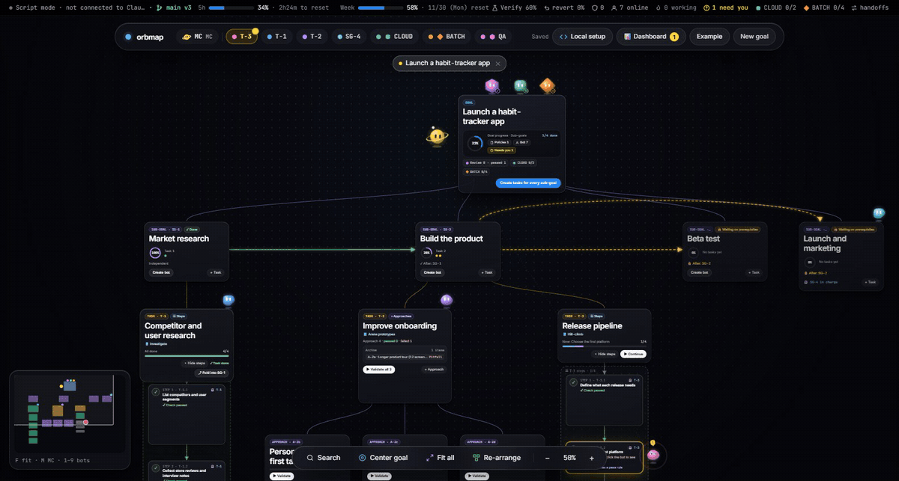

# orbmap

A spatial canvas for planning work with AI agents. You give it a goal; it splits the goal into sub-goals and tasks, puts one bot in charge of each task, and shows all of them working on one zoomable map.



> **Two modes.** Open `index.html` in a browser and the bots run on a built-in script, so you can try the whole flow without anything installed. Start the desktop app and every bot is a real [Claude Code](https://docs.claude.com/en/docs/claude-code) session working in your project (see [Live mode](#live-mode-real-claude-code-sessions)).

## Quick start

1. Download or clone this repository.
2. Open `index.html` in a browser (Chrome, Edge, Firefox or Safari). There is no build step and no server.
3. Press **Example** at the top to load a half-finished plan, or type a goal into the MC chat on the right.

`index.html` loads Tailwind CSS and fonts from a CDN. To use it without internet, build the offline copy once (needs Node.js):

```bash
python tools/build_offline.py      # writes dist/index.offline.html
```

## How it works

### The map

```
Goal ─┬─ Sub-goal ── Task ── steps      (one after another)
      ├─ Sub-goal ── Task ── approaches (side by side, in parallel)
      ├─ Sub-goal ── Task ── checklist  (no order, each item verified)
      ├─ Sub-goal ── Task ── loop       (rounds until a score meets its target)
      ├─ Sub-goal ── Task ── fan-out    (split → parts side by side → merge)
      ├─ Sub-goal ── Task ── decision   (find the case → only that branch runs)
      ├─ Sub-goal ── Task ── matrix     (every combination of two parameters)
      └─ Sub-goal ── Task ── stage-gate (stages with an approval or a check between them)
```

- **Goal**: what you want to achieve. **MC** (Model Controller) owns it: it restates your goal, proposes a split into sub-goals, passes your policies on to every bot, and collects their reports.
- **Sub-goals** can depend on each other. Dependencies are drawn as arrows, and a locked sub-goal waits until the ones before it are done.
- **Tasks** are where the work happens. Each task picks a template:
  - **Steps**: work that runs in order. Bots can insert steps, or split one step into two methods and keep the better one.
  - **Approaches**: several ways to solve the same problem, tried in parallel. Passed approaches can be adopted one by one, because more than one thing may be missing. If a later result shows an adopted approach was wrong, it can be retracted.
  - **Checklist**: items without an order. Tick them yourself, or let the bot verify the open ones; an item that does not hold says why.
  - **Iteration loop**: run → evaluate → improve, one card per round. Every round reports a score; rounds are added until the score meets the target or the round limit. The task card shows the scores against the target.
  - **Fan-out**: one step splits the work, the parts run side by side, one step merges them.
  - **Decision tree**: one step finds out which case applies; only the matching branch runs and the others are greyed out as skipped.
  - **Matrix**: every combination of two parameters (for example 2 options × 3 settings) gets a cell, laid out as a grid. Every cell reports the same metric; the task card shows them as a small heatmap with the best cell marked.
  - **Stage-gate**: stages in order, and after each stage a gate. A 🔒 gate waits for you (**Approve** or **Send back**); a ✓ gate is a check the bot runs against written criteria, and a failed check sends the stage back for rework (at most twice, then it asks you).
  - In live mode the items of a task run in the task's own session one after another, so they never write over each other; script mode shows fan-out parts running side by side.
- **Visual contract.** Every step says up front how its result will be shown, and its card draws that as a wireframe before anything runs: a table with its columns, a metric with its target, an audit list, a diff of a file, a parity plot (predicted vs measured), a box plot against limits, a heatmap of zones, a before/after comparison, or a short note. When the step is done, the same template is filled with the real data plus a one-line badge; nothing repeats the step's description. You can switch the format in the side panel before it runs, or ask the bot for another column.
- Templates live in registries (`TEMPLATES` for tasks, `RESULT_TEMPLATES` for results). See [docs/templates.md](docs/templates.md).
- **Several goals.** **+ New goal** opens a new tab with its own canvas and view; your other goals stay as they are. In live mode every tab has its own sessions.

### The bots

- **One bot = one session.** Each task has its own bot, named after the task (`T-3`). It only sees its own line of the map (goal → sub-goal → task), not its siblings.
- **Subagents** show up as small bots of the same color. They fly to the card they are working on and are recalled when done.
- When a bot needs you, it stops and pins a **30-second brief**: background, problem, impact, and options with a recommendation. One click answers it.
- When a bot's context is nearly full, it writes a handoff note, starts a fresh session, and reads the note back.

### Review gate and main

Work that changes the shared result (**main**) goes through a **review gate** before it is merged:

1. Design constraints → static checks → tests → re-verify after merging → written rules → you (only when nothing else can decide).
2. If the re-verification after a merge does not match what was expected, the merge is reverted automatically.
3. The same problem seen twice becomes an automatic check.

Each merge bumps main's version and tells every task that depends on it.

**Workers** run long jobs for the bots: the cloud worker uploads, runs and downloads; the batch worker queues local runs. Their mascots fly to the card whose job they are running.

### When you are away

Press **📊 Dashboard** (or `L`) for a log of what happened while you were gone. Every entry has a reason, and decisions waiting for you are listed first. It also opens by itself when you come back to the tab and something changed.

## Live mode: real Claude Code sessions

The idea is simple: if you already work with several Claude Code sessions (one per task, plus one that coordinates), orbmap is a map of exactly that. Every bot on the canvas **is** a Claude Code session, the same kind you open in a terminal or in VS Code. The app only draws them and passes messages.

```bash
pip install pywebview
python app/orbmap.py path/to/workspace          # desktop window
pyw app/orbmap.py path/to/workspace             # Windows: same window, no console (output in .atlas/app.log)
python app/orbmap.py path/to/workspace --browser   # no pywebview: opens http://127.0.0.1:8765 in your browser
```

Needs Python 3.10+ and the `claude` CLI, signed in. The workspace becomes a git repository if it is not one yet.

| On the canvas | In Claude Code |
| --- | --- |
| MC | one session in the workspace folder; the only one that sees the whole tree |
| a task's bot | one session in that task's own git worktree (`.atlas/wt/T-1`, branch `task/T-1`) |
| an approach | a separate session in its own worktree (`exp/A-1a`), branched from the task |
| QA | one session that reviews the real diff, runs the tests, and merges into `main` |
| Cloud / Batch worker | one session each that takes jobs from other bots (for example with your own skills for a remote server) and reports where the results are |

- **Chat is a normal session turn.** Ask a bot to do something, add steps or try another approach, and it does; it answers with text plus actions the app turns into cards. Buttons on cards just send the session a sentence.
- **Your setup loads as usual.** Sessions read your `CLAUDE.md`, skills, MCP servers and hooks, like any Claude Code session.
- **Close and reopen.** The canvas is saved in `<workspace>/.atlas/state.json` and each bot keeps its session id, so reopening continues the same conversations. Steps that were running are offered to resume; long worker jobs are checked again.
- **Handoff.** When a session's context passes 85%, it writes a handoff note (`.atlas/handoff/`) and a fresh session continues from it.
- **Bring in sessions you already have.** Press **Import sessions** (bottom left) and pick a folder: orbmap lists the Claude Code sessions saved for it and you choose which one is MC, a worker or a task. An imported session keeps its folder and history, and orbmap does not touch git for it. *Take over* continues the same session; *Fork* works on a copy and leaves the original untouched.
- **Sessions talk to each other.** Ask T-2 to discuss something with MC, or to brief another bot: a session can `ask` another one (the answer comes back and they can go back and forth, up to 6 rounds) or `tell` it something it should know. It can also ask any other Claude Code session on your computer by its title; orbmap talks to a fork, so that session itself is left exactly as it was.
- **MC sees your other sessions.** MC gets the list of Claude Code sessions on this computer (titles as shown in VS Code, folders, transcripts), can tell you what they are about, and can propose bringing one onto the canvas.
- **The input box works like Claude Code's.** Enter sends, Shift+Enter adds a line (IME-safe), **+** attaches images or files (or paste / drop them; the session reads them), **/** lists your skills and custom commands plus `/clear`, `/compact`, `/model`, `/status`, `/handback`, `/cost`. The toolbar shows context, running subagents and the model; you pick the model and effort per bot, switch the permission mode (Auto / Plan / Bypass), stop a running turn, and queue messages while a bot is busy.
- **Hand a session back.** In a bot's panel, **Continue in terminal** copies `claude --resume <id>` and orbmap stops sending it anything until you press **Take back**. Never use one session from two places at once.

Agents can edit files and run commands inside their folders (`acceptEdits`, Bash allowed; `git commit/push/checkout/merge` are blocked for managed tasks because the app does the git work). Try it on a scratch workspace first.

**Bypass** mode turns off every permission check for that bot, so only use it in a workspace you can throw away. Every bot is a real Claude Code session and uses your own Claude plan or API usage; several bots working at once use it up faster.

## Keyboard

| Key | Action |
| --- | --- |
| `Ctrl+K` | Search cards and bots |
| `Ctrl+Z` | Undo (drags, deletes, folds) |
| `F` | Fit everything (the **Center goal** button centers the goal) |
| `M` | Open MC |
| `1`–`9` | Jump to a bot |
| `L` | Dashboard |
| `Esc` | Close the side panel |

Click empty canvas to close the side panel and bring every card back to full brightness.

## Customize

Everything scenario-specific lives in a **scenario pack** (`PACKS.general` in `index.html`): how goals split into sub-goals, task templates, step and approach lists, metrics, the 30-second briefs and the example map. Copy it, change the content, and point `PACK` at your copy. Details in [docs/templates.md](docs/templates.md).

## Tests

```bash
pip install selenium
python tests/test_ui.py               # tests index.html
python tests/test_ui.py --offline     # tests dist/index.offline.html
```

The suite drives the full flow in headless Chrome (121 checks) and saves screenshots to `test_shots/`.

## Roadmap

- Live mode polish: per-worker setup in the UI, cheaper status checks for long jobs, usage from the real account.
- Tabs that keep working in the background while you look at another goal.
- Usage split per task.

See [docs/architecture.md](docs/architecture.md) for how the code is organized.

## License

[MIT](LICENSE)

orbmap is an independent project and is not affiliated with or endorsed by Anthropic. Claude and Claude Code are trademarks of Anthropic.

Third-party parts, loaded at run time and not included in this repository: [Tailwind CSS](https://tailwindcss.com) (MIT), the fonts Inter, JetBrains Mono and Noto Sans TC from Google Fonts (SIL Open Font License 1.1), [pywebview](https://pywebview.flowrl.com) (BSD-3-Clause), optional [psutil](https://github.com/giampaolo/psutil) (BSD-3-Clause), and [Selenium](https://www.selenium.dev) for the tests (Apache-2.0).
